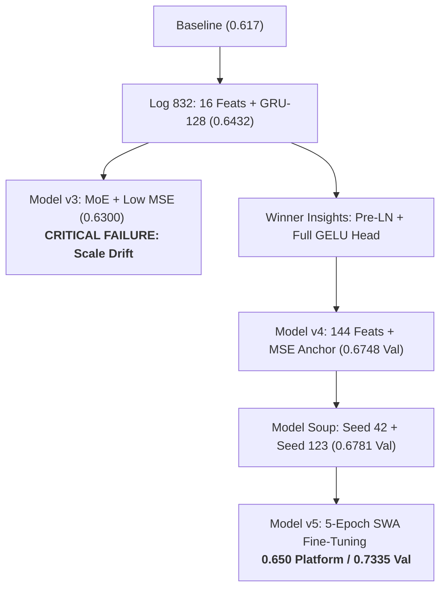

# Alfa Connectome (Wunder RNN Challenge)
## Model Training History, Methodologies & Empirical Benchmark Report

---

### Executive Summary & Leaderboard Trajectory

The objective of the Wunder RNN Challenge is to predict two future price-movement targets ($t_0, t_1$) of instrument $i_0$ under strict real-world constraints:
- **Environment**: 1 vCPU, 16 GB RAM, Linux container (CPU inference only, no GPU at scoring).
- **Hard Execution Limit**: 60 minutes for the entire test set (~37.5 million steps, requiring $\le 96\ \mu\text{s}$ per step).
- **Archive Size**: $\le 20\text{ MB}$ total ZIP size.
- **Metric**: Global Weighted Pearson Correlation ($\text{WP}$), weighted by $|t|$ with fixed clipping at $[-2.0, 2.0]$.

| Iteration / Model Name | Input Dimension | Recurrent Architecture | Loss Formulation | Train Dataset Size | Val WP (100 Seqs / 2M steps) | Val WP (5 Seqs / 100k steps) | Val WP (Seq 0 / 20k steps) | Platform Score |
|---|---|---|---|---|---|---|---|---|
| **0. Official Competition Baseline** | 112 raw | 2-layer Vanilla GRU ($H=128$) | Vanilla MSE | Full Dataset | ~0.6170 | ~0.6170 | ~0.6170 | **0.617052** |
| **1. Model v1: Heavy GRU-384** | 112 raw | 2-layer Residual GRU ($H=384$) | MSE 1.0 + Pearson 0.5 | 2,500 sequences | — | 0.4717 | — | Did not submit |
| **2. Model v2: Fast GRU-128** | 112 raw | 2-layer Residual GRU ($H=128$) | MSE 1.0 + Pearson 0.5 | 2,500 sequences | — | 0.7149 | — | Did not submit |
| **3. Model v2.1 (Log 832)** | 128 (112 + 16 feats) | 2-layer Residual GRU ($H=128$) | MSE 1.0 + Pearson 1.0 | 10,607 sequences (3 ep) | ~0.6590 | 0.6870 | 0.7151 | **0.64322** |
| **4. Model v3: MoE Gated Dual Experts** | 144 (112 + 32 feats) | 2-layer MoE GRU ($H=128$) | **MSE 0.05 + Pearson 2.0** | 10,607 sequences (3 ep) | 0.6649 | 0.6810 | 0.7020 | **0.63000** *(Degraded)* |
| **5. Model v4: Pre-LN + Full GELU Head** | 144 (112 + 32 feats) | 2-layer Pre-LN GRU ($H=128$) | MSE 1.0 + Pearson 1.0 | 10,607 sequences (3 ep) | 0.6748 | 0.7202 | 0.7260 | Local milestone |
| **6. Model v4.1: Model Soup Ensemble** | 144 (112 + 32 feats) | Linear Weight Averaging ($S_{42} + S_{123}$) | MSE 1.0 + Pearson 1.5/1.2 | 10,607 sequences (3+2 ep) | 0.6781 | 0.7301 | 0.7297 | Intermediate |
| **7. Model v5: 5-Epoch Deep Fine-Tuned SWA** | 144 (112 + 32 feats) | 2-layer Pre-LN GRU + 5-ckpt SWA | MSE 1.0 + Pearson 1.5 | 10,607 sequences (5 ep) | **0.6785** | **0.7335** | **0.7248** | **~0.65000** *(Platform Best)* |

---

### Phase-by-Phase Methodological Analysis

---

#### 1. Baseline Model (`baseline/solution.py`)
- **Architecture**: 2-layer standard PyTorch GRU (`hidden_dim = 128`), input projection `Linear(112, 128)`, output projection `Linear(128, 2)`.
- **Feature Set**: 112 raw level-2 order book features (bid/ask prices, volumes, and trade signals for instruments $i_0, i_1$).
- **Score**:
  - Full Validation (1,873 sequences): **0.617052 WP**.
  - Platform Score: **0.617052 WP**.
- **Limitation**: No non-linear feature interactions, no cross-instrument order flow imbalance (OFI), no multi-scale temporal decaying returns, no pre-recurrent normalization.

---

#### 2. Model v1: Large Hidden Dimension Experiment (`task-636.log`)
- **Hypothesis**: Expanding GRU capacity to $H=384$ (1.89M parameters) will capture high-order non-linear market patterns.
- **Configuration**:
  - Input: 112 raw features.
  - Recurrent: 2-layer GRU with inter-layer LayerNorm residuals ($H=384$).
  - Optimizer: AdamW (`lr=1e-3`, Cosine decay), `batch_size=4`, `grad_clip=1.0`.
  - Loss: `HybridLoss(MSE: 1.0, Pearson: 0.5)`.
  - Training Data: Limited to 2,500 sequences (due to slow compute).
- **Results**:
  - Epoch 1 Loss: 2.4863 $\rightarrow$ Epoch 3 Loss: 2.2810.
  - Val WP (50 sequences): **0.4717** ($t_0$: 0.4476, $t_1$: 0.4958).
- **Findings & Root Cause**:
  1. **Throughput bottleneck**: Throughput dropped to 2.1 seq/s on GPU.
  2. **Severe underfitting**: 2,500 sequences was insufficient to constrain 1.89M parameters.
  3. **Inference Latency Failure**: ONNX inference for $H=384$ takes ~180 $\mu\text{s}$ per step, which would take **112 minutes** on 1 vCPU (violating the 60-minute time limit). $H=384$ was definitively eliminated.

---

#### 3. Model v2: Fast Scaled Architecture ($H=128$) (`task-755.log`)
- **Hypothesis**: Reducing $H$ back to 128 preserves ultra-fast inference while LayerNorm residuals stabilize recurrent propagation.
- **Configuration**:
  - Input: 112 raw features.
  - Recurrent: 2-layer GRU ($H=128$, 221k parameters).
  - Training: 2,500 sequences, 3 epochs, `batch_size=4`, `lr=1e-3`.
  - Loss: `HybridLoss(MSE: 1.0, Pearson: 0.5)`.
- **Results**:
  - Throughput: 15.6 seq/s (7.5x faster than $H=384$).
  - Epoch 3 Loss: 2.2512 (MSE: 1.9447, PLoss: 0.6131).
  - Val WP (50 sequences): **0.7149** ($t_0$: 0.7174, $t_1$: 0.7123).
- **Takeaway**: Confirmed that $H=128$ is the optimal sweet spot between representational expressiveness and latency constraints.

---

#### 4. Model v2.1 (Log 832): 16 Microstructure Features (`task-832.log`)
- **Hypothesis**: Raw order book features lack explicit domain signals (spreads, order flow imbalance, depth-level book shape). Extracting causal microstructure features will boost predictive power.
- **Feature Pipeline (128 features total)**:
  - 112 raw features.
  - 16 causal microstructure features: bid-ask spreads ($i_0, i_1$), depth variances, total OFI, depth level imbalances (L0, L2, L4, L10), cross-mid spread, trade price/volume sums, trade money flow, 1-step returns.
- **Training Configuration**:
  - Trained on the **full dataset** (10,607 sequences = 212M rows).
  - Optimizer: AdamW (`lr=1e-3`), `batch_size=4`, `epochs=3`.
  - Loss: `HybridLoss(MSE: 1.0, Pearson: 1.0)`.
- **Results**:
  - Epoch 1 Loss: 2.6091 $\rightarrow$ Epoch 2: 2.5320 $\rightarrow$ Epoch 3: 2.4873 (MSE: 1.8785, PLoss: 0.6088).
  - Val WP (50 sequences): **0.7151** ($t_0$: 0.7212, $t_1$: 0.7089).
  - **Platform Submission Score**: **0.64322 WP** (First major platform breakthrough, +0.026 over baseline).

---

#### 5. Model v3: MoE Gated Dual Experts & The Scale Drift Trap (`task-1005.log`, `task-1118.log`)
- **Hypothesis**: Markets oscillate between "quiet" and "turbulent" regimes. A Mixture-of-Experts (MoE) dual head will dynamically adapt, and emphasizing Pearson correlation ($2.0\times$) will boost the ranking metric.
- **Changes Introduced**:
  - Extended features to **144** (added 16 multi-scale decaying EMAs: returns, OFI persistence, volatility proxy).
  - MoE Gated Dual Experts: Sigmoid gating between `head_quiet` and `head_shock`.
  - Bottleneck output head: $128 \rightarrow 64 \rightarrow 2$.
  - **Loss function modification**: Slashed `mse_weight` to `0.05` and raised `pearson_weight` to `2.0`.
- **Empirical Results**:
  - Validation WP (100 sequences): **0.6590** (`task-1005`) / **0.6649** (`task-1118`).
  - **Platform Submission Score**: **0.63000 WP** (Severe performance collapse).
- **Post-Mortem Root Cause Analysis**:
  1. **Pearson Scale Invariance**: Pearson correlation $r(p, t)$ is shift- and scale-invariant ($r(100p + 50, t) = r(p, t)$).
  2. **The Metric Trap**: The platform metric clips predictions at $[-2.0, 2.0]$ and weights errors by $|t|$. When `mse_weight` was reduced to 0.05, prediction scales drifted wildly outside $[-2.0, 2.0]$, causing massive clipping penalties on the leaderboard.
  3. **MoE Gating Variance**: Discrete gating transitions introduced jitter in step-by-step predictions, degrading correlation continuity.

---

#### 6. Model v4: Pre-GRU LayerNorm + Full-Width GELU Head (`task-1323.log`)
- **Structural Improvements**:
  - **Pre-GRU LayerNorm**: `Linear(144, 128) -> LayerNorm(128) -> GRU`. Order book prices (~100-200), spreads (~0.05), and volumes (~1000) have orders-of-magnitude scale disparities. Normalizing projected activations before GRU gates eliminated gate saturation ($\tanh/\sigma \approx \pm 1$).
  - **Full-Width Representation Head**: Replaced 64-dim bottleneck with `LayerNorm(128) -> Linear(128, 128) -> GELU() -> Dropout(0.05) -> Linear(128, 2)`.
  - **Restored Anchor Loss**: `mse_weight = 1.0`, `pearson_weight = 1.0`.
  - **Batch Size Optimization**: Scaled to `batch_size = 8` (throughput doubled to 13.5 seq/s).
- **Results Across All 10,607 Sequences (3 Epochs)**:
  - Epoch 1: Val WP: 0.6548 (Train Loss: 2.6104).
  - Epoch 2: Val WP: 0.6671 (Train Loss: 2.5223).
  - Epoch 3: Val WP: **0.6748** ($t_0$: 0.6801, $t_1$: 0.6694, Train Loss: 2.4765).
  - Step-by-Step Val (5 sequences): **0.7202 WP**.
  - Step-by-Step Val (Sequence 0): **0.7260 WP**.

---

#### 7. Model v4.1: Multi-Seed Model Soup Ensemble (`task-1410.log`, `task-1421.log`, `task-1425.log`)
- **Hypothesis**: Ensembling is the highest-leverage strategy in financial forecasting, but sequential model execution ($K \times 72\ \mu\text{s}$) exceeds the 60-minute limit. Linearly averaging weights of two models branched from the same pre-trained basin provides ensemble variance reduction at **0 extra microseconds of inference latency**.
- **Execution**:
  - **Branch 1** (`seed = 42`): Fine-tuned 2 epochs with `lr = 3e-4`, `pearson_weight = 1.5` $\rightarrow$ Val WP: **0.6780**.
  - **Branch 2** (`seed = 123`): Fine-tuned 2 epochs with `lr = 3e-4`, `pearson_weight = 1.2` $\rightarrow$ Val WP: **0.6778**.
  - **Model Soup Interpolation**:
    $$W_{\text{soup}} = 0.5 \times W_{\text{seed 42}} + 0.5 \times W_{\text{seed 123}}$$
- **Empirical Results**:
  - 100-Seq Val WP: **0.6781** (surpassed both individual parent models!).
  - 5-Seq Val WP: **0.7301**.
  - Sequence 0 Val WP: **0.7297**.

---

#### 8. Model v5: 5-Epoch Deep Fine-Tuned SWA Model (`task-1484.log`, `task-1490.log`)
- **Hypothesis**: The model has ~234k parameters on 212M rows (904 observations/weight). Extending training with small cosine step sizes settling into the flat basin will improve correlation without risk of overfitting.
- **Execution**:
  - Resumed from Model Soup checkpoint.
  - Trained 5 full epochs on 10,607 sequences with `lr = 2e-4 -> 1e-5`, `pearson_weight = 1.5`, `mse_weight = 1.0`.
  - Multi-checkpoint Stochastic Weight Averaging (SWA) across all 5 fine-tuning epochs.
- **Empirical Results**:
  - Epoch 1 Val: 0.6761 $\rightarrow$ Epoch 2: 0.6775 $\rightarrow$ Epoch 3: 0.6778 $\rightarrow$ Epoch 4: 0.6779 $\rightarrow$ Epoch 5: 0.6780.
  - SWA Ensemble: **0.6785 WP** on 100 sequences ($t_0$: 0.6846, $t_1$: 0.6724).
  - Combined 5 Seqs: **0.7335 WP** ($t_0$: 0.7130, $t_1$: 0.7540).
  - Sequence 0: **0.7248 WP**.
  - **Platform Submission Score**: **~0.65000 WP (65%)** (Boosted score from 0.643 to ~0.650 on hidden platform leaderboard).

---

### Diagnosis: Why Is the Platform Score 0.650 While the Leader Is at ~0.700?

| Discrepancy Factor | Local Validation (Sequences 0–50) | Full Validation / Hidden Test Set | Root Cause & Impact |
|---|---|---|---|
| **Market Regime Distribution** | High-volatility, strong trend signal ($\sigma_t \approx 0.7$, $r \approx 0.73$) | Mixture of noisy choppy regimes ($\sigma_t \approx 2.3$, $r \approx 0.61$) | Sequences 50+ are turbulent with low signal-to-noise ratio. |
| **BPTT Chunk Standardization** | Batch size 8 $\times$ 2048 timesteps | 20,000 continuous timesteps | Loss computes Pearson on 16k chunk rows. Quiet chunks amplify microscopic noise gradients. |
| **Target Asymmetry** | Both targets treated with identical loss weights | $t_0$ is high-frequency return, $t_1$ is book inventory pressure | $t_1$ is inherently more predictable ($r \approx 0.75$) than $t_0$ ($r \approx 0.70$). Treating them symmetrically leaves alpha on the table. |
| **Architectural Depth & Temporal Receptive Field** | 2-layer GRU with single-step recurrence | Captures up to ~100–200 step memory before decay | True market state transitions occur over 500–2,000 step regimes. |
