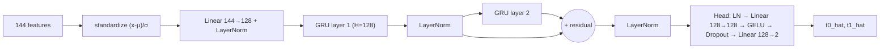
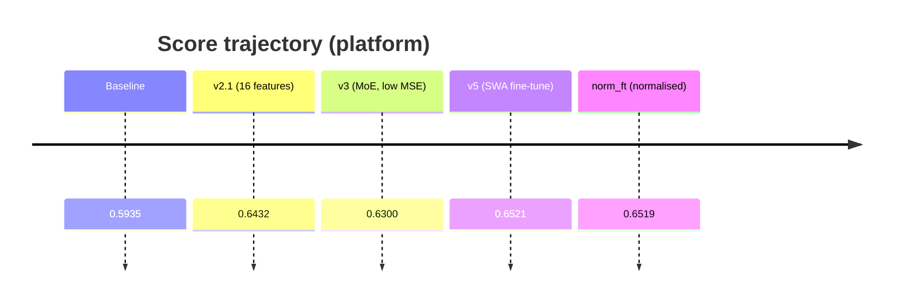

# Wunder RNN Challenge (Alfa Connectome): the data, the approaches, and why we are stuck

Written for a strong software engineer with ML background and no finance background.
Every number has a source in brackets. Sources are files in this repo; `[EDA-2026-10-29]` marks numbers from
read-only analysis run while writing this report (`runs/eda_report.py`, output in `runs/eda_report.log`,
plus two short inline checks described where used). Statements marked **Hypothesis** are not proven.

---

## 0. The short version

- **The task.** At every step of a 20,000-step stream of order-book snapshots for two instruments, predict two
  numbers, `t0` and `t1`, describing the *future* price movement of instrument `i0`. Inference runs step by
  step on 1 CPU within a hard time budget, so the model must be a small recurrent network.
- **Where we are.** Best platform score is **0.65207** (v5) [user report]. The leader is around 0.70.
  Our best full-validation score is **0.6815** (normalized fine-tune) [eval_full], which scored 0.65191 on the
  platform [user report].
- **Why we are stuck** (Section 9 has the detail):
  1. Every model we train, of any size and any training recipe, converges to roughly **0.68 on validation**.
     Capacity (H=128 → 256, 2 → 3 layers) changed nothing: all within 0.003 [runs/screen/results.txt].
  2. Every model loses **0.024–0.030 between validation and the platform**, including the organizers' baseline
     (0.6171 → 0.5935). So the test data differs from validation, and the drop is a property of the data, not
     of a bug in our models.
  3. Most of our engineered features re-derive things the network already sees, because they were designed
     for a "normal" order book. This data is anonymized and transformed (Section 4), so those assumptions do
     not hold.
- **The most important data facts we only discovered late** (Section 4.4, 4.5):
  - The targets are **discrete** (about 160 distinct values) and **piecewise constant**. They change on only
    ~13% of steps, and **only at steps where i0's price-like block changes** [EDA-2026-10-29].
  - The current row alone (no memory at all) already gets **0.624** with gradient boosting [runs/nowcast_probe.log].
    All our recurrent modelling adds only ~0.06 on top of that.

---

## 1. The problem

### 1.1 What is being asked

Wunder Fund is a quantitative trading firm. The challenge gives sequences of market snapshots for two trading
instruments, `i0` and `i1`, and asks for predictions of `t0` and `t1`, "two anon indicators of the future price
movement of instrument `i0`" [docs/data_overview.md]. Their exact definition is not disclosed. There are no
targets for `i1`; it is provided as extra input only.

### 1.2 Sequence structure

| Item | Value | Source |
|---|---|---|
| Rows per sequence | 20,000 (`step_in_seq` 0 … 19,999) | docs/data_overview.md |
| Warm-up | steps 0–98: `need_prediction = false`, no output | docs/data_overview.md |
| Required predictions | steps 99–19,999: two finite numbers each | docs/data_overview.md |
| Scored rows | a hidden subset of required rows (`is_scored`) | docs/data_overview.md |
| Train | 10,607 sequences = 212,140,000 rows | docs/data_overview.md |
| Valid | 1,873 sequences = 37,460,000 rows (has `is_scored`) | docs/data_overview.md |
| Test (hidden) | 1,970 sequences = 39,400,000 rows | docs/faq.md |

Sequences are independent. State must be reset when `seq_ix` changes, and `seq_ix` order means nothing
(sequences are shuffled in time) [docs/data_overview.md].

### 1.3 How the scorer runs a model

The platform imports `solution.py`, builds one `PredictionModel`, and calls `predict(data_point)` once per row,
in order. `data_point` carries `seq_ix`, `step_in_seq`, `need_prediction` and `state` (the 112 features). The model
never sees `is_scored` or targets, and may use only the current and earlier rows [docs/data_overview.md].

```mermaid
sequenceDiagram
    participant S as Scorer
    participant M as PredictionModel
    loop every row of every test sequence (39.4M calls)
        S->>M: predict(seq_ix, step, need_prediction, state[112])
        M->>M: reset state if seq_ix changed; update features + hidden state
        alt need_prediction
            M-->>S: [t0_hat, t1_hat]
        else warm-up
            M-->>S: None
        end
    end
    S->>S: apply hidden is_scored mask, compute Global Weighted Pearson
```

Because the model sees one row at a time and must remember the past cheaply, the natural design is a
**recurrent network** whose hidden state summarises history. Recomputing over a window of past rows at each
step would be far too slow.

### 1.4 Hard constraints and the time budget

1 vCPU, 16 GB RAM, CPU only, ZIP ≤ 20 MB, 60 minutes for the whole test set [docs/submission_guide.md,
docs/faq.md].

$$\frac{3600\ \text{s}}{39{,}400{,}000\ \text{steps}} = 91.4\ \mu\text{s per step, everything included.}$$

Earlier notes used 37.5M steps and 96 µs; that is the *validation* size, not the test size. v5 took 47 min 21 s
on the platform [user report] = 2,841 s / 39.4M = **72 µs/step**.

---

## 2. Just enough market background

This section explains the vocabulary the data descriptions use. Section 4 then explains how much of it
actually survives in this anonymized data.

**Limit order book (LOB).** An exchange keeps, for each instrument, a list of standing offers.
*Bids* are offers to buy ("I will buy 5 at 100.01"), *asks* are offers to sell ("I will sell 3 at 100.03").
Each distinct price with standing orders is a *level*; the quantity there is the *volume* (or depth).
"L11" data means the top 11 levels on each side are shown [docs/data_overview.md].

**Best bid / best ask / mid / spread.** The highest bid and lowest ask are the *best* quotes. Their average is
the *mid-price*, the usual "current price". Their difference is the *spread*. Example: best bid 100.01, best ask
100.03 → mid 100.02, spread 0.02. Prices move in fixed increments called *ticks* (e.g. 0.01).

**Trades.** A *market order* ("buy 4 now at any price") consumes volume from the opposite side of the book;
when it exhausts the best level, the best price moves. That is how prices move.

**Imbalance and order flow.** If there is much more volume on the bid side than on the ask side
(*depth imbalance*), buyers are queued up and the price tends to tick up next. *Order flow imbalance (OFI)* is
the classic short-term predictor: the *change* in bid-side volume minus the change in ask-side volume over a
step. It measures who is adding or removing liquidity, not just what is resting. The difference matters in
Section 5.

**Two instruments.** Related instruments (e.g. a future and its underlying) often move together, and one can
lead the other by a few moments. That is why `i1` is supplied as input.

**Why returns are weakly predictable.** At high frequency most price change is noise. Even good predictors
correlate only modestly with the future move, and the relationship drifts as market conditions (*regimes*:
quiet vs turbulent, high vs low volume) change. Absolute price levels are dangerous inputs: a model can
memorise "price was 100 in training" and that means nothing next month. This is called *non-stationarity*.

---

## 3. The metric, from first principles

### 3.1 Pearson correlation

Intuition: does the prediction go up when the target goes up, and by a consistent proportion?

$$\rho=\frac{\sum_i (y_i-\bar y)(\hat y_i-\bar{\hat y})}{\sqrt{\sum_i (y_i-\bar y)^2\,\sum_i(\hat y_i-\bar{\hat y})^2}}\in[-1,1].$$

Properties that matter here: it ignores shifts and scales of the prediction ($\rho(a\hat y+b,y)=\rho(\hat y,y)$
for $a>0$), so only the *shape* of the predictions counts. It is sensitive to large values, because the
squared deviations dominate.

### 3.2 Weighted Pearson as used by the competition

The scorer clips both targets and predictions to $[-2,2]$, and weights each row by the absolute clipped target
[METRIC.md, utils.py `GlobalAccumulator.add`]:

$$y_i=\mathrm{clip}(t_i,-2,2),\quad \hat y_i=\mathrm{clip}(p_i,-2,2),\quad w_i=|y_i|$$

$$\bar y_w=\frac{\sum w_i y_i}{\sum w_i},\qquad
\rho_w=\frac{\sum w_i(y_i-\bar y_w)(\hat y_i-\bar{\hat y}_w)}
{\sqrt{\sum w_i(y_i-\bar y_w)^2\;\sum w_i(\hat y_i-\bar{\hat y}_w)^2}},\qquad
S=\tfrac12(\rho_{w,t0}+\rho_{w,t1}).$$

Rows with target 0 have **zero weight**: they do not count at all. In this data that is about 22% of rows
(Section 4.4).

**Worked example.** Targets $y=[2,-1,0.5]$, predictions $\hat y=[1,0,1]$.

- Unweighted: $\bar y=0.5$, $\bar{\hat y}=0.667$, covariance sum 1.5, variances 4.5 and 0.667, so $\rho=0.866$.
- Weighted ($w=[2,1,0.5]$): $\bar y_w=0.929$, $\bar{\hat y}_w=0.714$, weighted covariance 1.929, variances 6.107
  and 0.714, so $\rho_w=0.923$.

The weighting favours getting the large-|target| rows right. The third row, which the prediction gets "wrong",
has small weight.

### 3.3 Global pooling

All scored rows of all sequences go into **one** correlation per target. Per-sequence scores are never averaged.
`GlobalAccumulator` merges per-sequence weighted moments exactly with the parallel-variance formula, so the
result equals one big calculation [utils.py lines 88–107].

Why it matters: a model that ranks rows perfectly *within* each sequence but has a different offset or scale per
sequence loses score. Example: sequence A has $y=[1,-1]$, $\hat y=[1,-1]$; sequence B has $y=[1,-1]$,
$\hat y=[3,1]$. Each sequence alone has $\rho=1$. Pooled, $\rho=4/\sqrt{32}=0.707$. Predictions must be
**calibrated across sequences and regimes**, not just correctly ordered.

### 3.4 Why scale still matters despite scale invariance: the v3 failure

Pearson ignores scale, but clipping does not. If a model's outputs are spread too widely, every prediction above
2 is flattened to 2. The rows with the biggest predicted moves, which are also the high-weight rows, lose their
ordering. v3 cut the MSE term to 0.05 (Section 7), which removed the force keeping output scale near the target
scale. It scored 0.630 on the platform versus 0.643 for v2.1 [docs/model_training_history_and_statistics.md].
The clipping explanation is the most plausible one, but it was not measured directly (**Hypothesis**).

---

## 4. The data: what it really is

This is the section to read slowly. The official description is a normal limit order book. The numbers below
show what has been transformed, and what structure exists that is not obvious from the column names.

### 4.1 The 112 input columns

Each row is one moment for both instruments [docs/data_overview.md]:

| Group | Columns | Index in `state` | Official meaning |
|---|---|---|---|
| i0 bid price-like | `i0_p0…p10` | 0–10 | 11 bid-side price components |
| i0 ask price-like | `i0_p11…p21` | 11–21 | 11 ask-side price components |
| i0 bid volume-like | `i0_v0…v10` | 22–32 | bid-side volumes |
| i0 ask volume-like | `i0_v11…v21` | 33–43 | ask-side volumes |
| i0 trades | `i0_dp0…3`, `i0_dv0…3` | 44–51 | 4 trade prices, 4 trade volumes |
| i1 (same layout) | `i1_*` | 52–103 | second instrument |
| additional | `a0…a7` | 104–111 | undisclosed |

Two official warnings shape everything [docs/data_overview.md, docs/faq.md]:

1. **"The index is an identifier, not a depth level."** `p0` is not necessarily the best bid, and `p10` is not
   necessarily the deepest. Indices 0–10 are bid side and 11–21 ask side, but there is no ordering by price.
2. **Values are "price-like" / "volume-like", i.e. transformed.** The FAQ says features are anonymized so that
   the competition is about modelling, not domain feature engineering.

### 4.2 What the columns look like in practice [EDA-2026-10-29, 150 random train sequences]

| Block | Changes on % of steps | Typical within-sequence std | Variance that is *between* sequences |
|---|---|---|---|
| i0 price-like (0–21) | 20.6% | 0.063 | 16% |
| i0 volume-like (22–43) | 89.8% | 0.447 | 25% |
| i0 trade price (44–47) | 32.8% | 0.586 | 4% |
| i0 trade volume (48–51) | 19.3% | 0.584 | 1% |
| i1 price-like (52–73) | 10.5% | 0.068 | 18% |
| i1 volume-like (74–95) | 47.5% | 0.333 | 24% |
| i1 trade price (96–99) | 23.2% | 0.606 | 6% |
| i1 trade volume (100–103) | 26.0% | 0.733 | 2% |
| a0–a7 (104–111) | 100% | 1.025 | 11% |

How to read this:

- **Everything is already scaled to roughly unit size.** No column looks like a raw price of 100.02 or a volume
  of 4,000. Values are around −2…+2 with standard deviations of 0.06–1.0.
- **Price-like columns are a "frozen snapshot" that jumps.** All 22 i0 price columns stay *exactly* unchanged on
  ~79% of steps and then move together (the per-column unchanged fraction is identical across all 22 columns
  [inline check, 440k rows]). They behave like one state that updates when the book's prices change. In one
  sequence (train row group 3000) i0 prices changed on only 3.4% of steps; in another (row group 0) on 34%.
- **The 22 price columns are largely one signal.** Their mean absolute pairwise correlation is 0.57, and the first
  principal component explains 67% of their variance (the top three explain 92%). Volume columns are far more
  independent: the first component explains only 20%.
- **Bid and ask are distinguishable.** The mean of the ask-side price columns is above the mean of the bid-side
  columns on 100% of rows. The *within*-side ordering is scrambled: the columns are never sorted
  [inline check, 440k rows].
- **i0 and i1 price blocks are often identical.** In 40% of entries `i1_p*` equals `i0_p*` exactly, but it is not
  a clean time-lagged copy (best-lag matches range from 5% to 78% depending on the sequence) [inline check].
- **Volume-like columns drift between sequences** more than anything else: a quarter of their variance is a
  per-sequence level. That is what makes train and validation distinguishable (Section 4.7).

### 4.3 What this means for "order book" features

Because indices are not depth levels and values are transformed, concepts such as "mid = average of bid and
ask price", "spread", "level-0 imbalance" or "OFI" **cannot be computed as defined**. Our feature code computes
*something* with those names (e.g. "mid" = mean of the 22 price-like columns), but it is an arbitrary linear
combination of inputs, not the market quantity. Section 5 shows the consequence: 14 of our 32 engineered
features are exact linear functions of the same row.

### 4.4 The targets: discrete, piecewise constant, event-driven

This is the most important structure in the data, and it was not visible in the original EDA.

**Distribution** [EDA-2026-10-29, 150 train sequences, prediction rows]:

| | t0 | t1 |
|---|---|---|
| mean | −0.294 | −0.268 |
| std | 1.004 | 0.993 |
| kurtosis (normal = 3) | 10.5 | 8.3 |
| exact zeros | 22.7% | 22.8% |
| \|t\| > 2 (clipped by metric) | 2.9% | 2.9% |
| quantiles 1 / 25 / 50 / 75 / 99 % | −1.97 / −0.66 / −0.47 / 0.00 / 3.14 | −1.97 / −0.66 / −0.47 / 0.00 / 2.90 |

**Discrete values.** In 60 sampled sequences, t0 takes only **161 distinct values** and t1 **156**. Twelve values
cover 78% of all rows [inline check]:

| value | share of rows (t0) |
|---|---|
| 0 | 21.0% |
| −0.6569 | 15.2% |
| −0.4685 | 11.2% |
| −1.4056 | 7.4% |
| −1.9706 | 6.0% |
| +0.4685 / +0.6569 | 3.5% each |
| −0.1254, −0.3763, −0.2413, +0.9371, −0.724 | 1.5–2.3% each |

Several values are multiples of two "units": 0.9371 = 2 × 0.4685, 1.4056 = 3 × 0.4685, 1.3137 = 2 × 0.6569,
1.9706 = 3 × 0.6569.
**Hypothesis:** the targets are price moves counted in ticks and then rescaled, possibly with different scaling
for different conditions. The distribution is skewed: at least 75% of values are ≤ 0, but the positive tail is
longer (99th percentile ≈ +3).

**Piecewise constant and tied to price updates.** In 40 sampled train sequences [inline check]:

- a target changes on **12.8%** of steps; the median run of an unchanged target is 2 steps (90th percentile 13);
- **every** target change happened on a step where the i0 price-like block also changed
  (P(price update | target changes) = 1.000);
- 61% of price updates change the target.

So the target is a function of the *book state*, re-evaluated when i0's prices change. Between price updates it
cannot change.
**Hypothesis:** the target is defined in *event time* (e.g. "price move over the next N book updates") rather than
in step time. If so, a model should think in book updates, not rows. Our features and GRU treat every row the
same.

**t0 and t1 are strongly opposite.** Their correlation is −0.75 pooled [EDA-2026-10-29] and −0.77 averaged per
sequence [runs/target_structure.log]. They are never both zero on the same row [inline check].
**Hypothesis:** they measure the movement of the two sides of the book (e.g. bid-side vs ask-side), which mostly
move in opposite "directions" relative to some reference.

**Memory scale.** Autocorrelation of t0: 0.958 at lag 1, 0.845 at lag 10, 0.385 at lag 100, 0.00 at lag 1000
[runs/target_structure.log]. Targets carry information over hundreds of steps, not thousands.

**Not a simple forward return of our "mid".** Correlation of t0 with the future change of our computed "mid"
(mean of price-like columns) is only −0.06 to −0.12 for horizons 1–2000. It is almost exactly mirrored by its
correlation with the *past* change (+0.06 to +0.12) [runs/target_structure.log]. Our "mid" is therefore not the
price the targets are defined on, which is consistent with Section 4.3.

### 4.5 How predictable is it? The predictability ladder

| What the model sees | Score | Source |
|---|---|---|
| Linear function of the current row | ≈ 0.37 (weighted corr 0.350 / 0.383) | runs/feature_audit.py output, 239k train rows |
| Gradient boosting (LightGBM) on the current row + 32 features | **0.624** | runs/nowcast_probe.log |
| LightGBM, current row + EMA history of all columns | 0.630 | runs/history_probe.log |
| Organizers' baseline GRU (112 raw) | 0.617 full valid | earlier full-valid run |
| Our best GRUs | 0.679–0.681 full valid | eval_full |

Interpretation:

1. **Most of the signal is in the current row, but nonlinear.** A linear model gets ~0.37, a tree model ~0.62.
2. **History adds only about 0.06**, and hand-made history features give a tree model only +0.006.
3. That explains why bigger GRUs do not help: the extra capacity has little left to find in this representation.

### 4.6 The scoring mask (`is_scored`) [EDA-2026-10-29, all 1,873 valid sequences]

- 9.42% of all rows are scored (3,528,273 rows with `need_prediction AND is_scored` [eval_full]). The 13% /
  4.87M figure mentioned once earlier was wrong.
- The per-sequence share varies a lot: 0.5% to 60%, median 7.8%. Every sequence has some scored rows. Sequences
  with many scored rows carry more weight in the global correlation.
- Scored rows come in short bursts: median run length 2 rows, 90th percentile 8; 44% of runs are a single row;
  median gap between runs is 5 rows, 90th percentile 81.
- Scored rows have somewhat larger targets: mean |t| 0.72 vs 0.62–0.63 on unscored rows.
- The mask is *not* tied to book events: P(scored | price update) = 6.0% vs 9.4% without an update
  [inline check, 40 sequences].
- An earlier classifier predicting `is_scored` from features reached AUC ≈ 0.66 [earlier session, runs/mask_clf.py].
  The mask is only weakly predictable, and training with extra weight on scored rows did not help (Section 7).

### 4.7 Train vs validation vs test: the distribution shift

- **A classifier can tell train rows from valid rows with AUC 0.93** (sequence-split, LightGBM)
  [runs/drift_check.log]. The most telling columns are volume-like (`i1_v18`, `i0_v3`, `i1_v17`, `i1_v3`) and `a3`.
  Their means differ between train and valid by 0.05–0.3 standard deviations.
- Replacing volumes by "deviation from their own recent average" lowers this to 0.82–0.87, but does not remove it
  [runs/drift_check_relative.log].
- **Targets are less volatile in validation:** std 0.87–0.88 vs 1.00 in train [EDA-2026-10-29].
- **Regimes differ strongly between sequences:** per-sequence target std ranges from 0.34 to 1.85–2.0
  (median 0.9), and per-sequence target means vary with std 0.19–0.21 [EDA-2026-10-29].
- **Validation-to-platform drop**, measured on every model submitted:

| Model | Full valid | Platform | Drop |
|---|---|---|---|
| Organizers' baseline | 0.6171 | 0.59353 | −0.024 |
| v5 | 0.679396 | 0.65207 | −0.027 |
| normalized fine-tune | 0.681455 | 0.65191 | −0.030 |

(Platform numbers: user reports. The older claim that the baseline scored exactly its validation score on the
platform was wrong.)

The drop is the same for a plain baseline and for our best models, so it is a property of the test data. The
test set is most likely drawn from a different period with different volume levels and volatility.
Validation still *ranks* models correctly; it is just optimistic by about 0.027. To reach 0.70 on the platform,
a model needs roughly **0.73 on full validation**.

---

## 5. Feature engineering

### 5.1 Versions

| Version | Inputs | Used by |
|---|---|---|
| raw | 112 raw columns | baseline, v1, v2 |
| 128 | raw + 16 "microstructure" features (#1–16 below) | v2.1 |
| 144 non-stationary | raw + 32 features; #4 = "mid", #31 = "mid − first mid" | v3, v4, v5 |
| 144 stationary | price columns minus "mid"; #4 → spread (duplicate of #1), #31 → EMA(ret, 0.002) | Step 2 onward, norm_ft |

Every feature is causal (uses the current and past rows only). Batch and online extraction agree to < 1e-5
[src/features.py docstring; C-kernel parity 1.9e-5].

### 5.2 The 32 engineered features and the audit [runs/feature_audit.py, 239k train rows]

"R² raw" = how well a linear function of the *same row's* 112 raw values reproduces the feature. R² = 1 means the
network's first linear layer already has it for free. "corr" = |t|-weighted correlation with the target.

| # | Name in code | Formula (as implemented) | R² raw | corr t0 / t1 | Verdict |
|---|---|---|---|---|---|
| 1 | spread0 | mean(p11–21) − mean(p0–10) | 1.000 | −0.17 / 0.01 | redundant |
| 2, 3 | disp_b0, disp_a0 | std across the 11 bid / ask price columns | 1.000 | −0.18 / −0.02, −0.06 / −0.11 | redundant |
| 4 | f4 | stationary: **identical to #1** | 1.000 | — | **duplicate (bug)** |
| 5 | "ofi0" | Σ bid volumes − Σ ask volumes (a depth snapshot, not order flow) | 1.000 | −0.08 / −0.10 | redundant, misnamed |
| 6–9 | imb L0/L2/L4/L10 | v_k − v_{k+11} for k = 0, 2, 4, 10 (indices are not levels) | 1.000 | up to −0.18 | redundant |
| 10–14 | spread1, midgap, ofi_diff, dp_sum, dv_sum | linear combinations | 1.000 | ≤ 0.10 | redundant |
| 15 | money_flow | Σ trade price × trade volume | 0.67 | 0.02 / −0.03 | some new info, weak |
| 16 | ret0 | 1-step change of "mid" | 0.61 | 0.02 / 0.02 | weak |
| 17–20 | EMA returns (α 0.2, 0.05, 0.01), divergence | | 0.40–0.56 | up to 0.10 | useful (history) |
| 21–24 | EMA "ofi" (α 0.2, 0.05, 0.01), persistence | | 0.43–0.94 | up to −0.15 | partly redundant |
| 25–27 | i1 return EMA, lead-lag, EMA midgap | | 0.32–0.89 | ≤ 0.05 | weak |
| 28 | EMA(ret²) (volatility) | | 0.41 | −0.11 / 0.08 | useful |
| 29 | EMA trade volume | | 0.36 | −0.13 / **0.17** | most useful |
| 30 | EMA money flow | | 0.17 | 0.08 / −0.10 | useful |
| 31 | EMA(ret, 0.002) (stationary) | | 0.64 | **0.12** / 0.06 | useful |
| 32 | "ofi" shift i1 vs i0 | | 0.90 | 0.09 / 0.09 | partly redundant |

For comparison, the best *linear* combination of the whole raw row reaches 0.35 / 0.38.

Conclusions:

- **Correct as code, wrong as finance.** The formulas do what they say, but the names (spread, OFI, levels)
  assume a book layout this data does not have.
- **#1–14 add no information.** They are harmless, but they made the 32-feature upgrade look bigger than it is.
- **#4 duplicates #1** in the stationary version.
- **The useful ones are slow averages over history:** trade volume, money flow, long-horizon "return",
  volatility. That points to *history-based* features as the productive direction.
- **True order flow (changes in volumes) is absent** from the feature set.

### 5.3 Online pipeline

At inference, features are computed one row at a time. The state between rows is: previous "mid" of each
instrument, and 13 EMA accumulators. An EMA is updated as $E \leftarrow E + \alpha(u - E)$. At step 0 each EMA is
initialised to its input, and returns are 0 [src/features.py `OnlineFeatureExtractor`; runs/ckernel/wnn_step.c
`features`].

### 5.4 Normalization (added in Step 2 / norm_ft)

Feature scales ranged over a factor of about 57,000 (std 8e-5 to 4.8), and the smallest were exactly the new EMA
features [earlier session, plan]. Per-feature standardisation, $z=(x-\mu)/\sigma$ with $\mu,\sigma$ from 1,000
train sequences [src/compute_norm_stats.py], is now built into the model as buffers. Its measured effect was only
+0.002 on full valid [eval_full: 0.6815 vs 0.6794]; the LayerNorm after the input projection had been
compensating already.

---

## 6. Model and training

### 6.1 Architecture (ScaledWunderGRU, src/model.py)



**GRU.** At each step, with input $x_t$ and previous hidden state $h_{t-1}$:

$$r_t=\sigma(W_{ir}x_t+b_{ir}+W_{hr}h_{t-1}+b_{hr}),\qquad z_t=\sigma(W_{iz}x_t+b_{iz}+W_{hz}h_{t-1}+b_{hz})$$
$$n_t=\tanh(W_{in}x_t+b_{in}+r_t\odot(W_{hn}h_{t-1}+b_{hn})),\qquad h_t=(1-z_t)\odot n_t+z_t\odot h_{t-1}$$

The *reset gate* $r$ decides how much past to use when proposing a new state; the *update gate* $z$ decides how
much of the old state to keep. A GRU can hold information for many steps when $z\approx1$.

**LayerNorm** rescales a vector to zero mean and unit variance, then applies a learned scale and shift. This keeps
gate inputs in a sensible range. **Residual** connections add a layer's input to its output, which eases
optimisation. **GELU** is a smooth ReLU-like nonlinearity. About 234k parameters
[docs/model_training_history_and_statistics.md].

### 6.2 Loss

HybridLoss = $w_{mse}\cdot$ (|t|-weighted MSE) $+\ w_p\cdot(1-\rho_w)$, where $\rho_w$ is the weighted Pearson
correlation pooled over the batch [src/model.py `HybridLoss`].

- The Pearson term optimises what is scored.
- The MSE term anchors the *scale* of predictions near the targets, which protects against clipping
  (Section 3.4).

The usual setting is MSE 1.0, Pearson 1.5.

### 6.3 Training procedure

- **Truncated BPTT.** Each 20,000-step sequence is cut into 2,048-step chunks. Gradients flow within a chunk,
  and the hidden state is carried (without gradient) into the next chunk.
- **Optimiser.** AdamW with cosine learning-rate decay and gradient clipping; batch of 8 sequences.
- **SWA / model soup.** Averaging the weights of checkpoints from the same training run (SWA), or of two
  fine-tuned branches (soup). This finds a flatter, more robust solution at no inference cost. It is *not* an
  ensemble: the averaged models are nearly identical, so the gain is small (+0.0003 to +0.0006 on the 100-sequence
  subset [docs/model_training_history_and_statistics.md]).

### 6.4 Inference speed

| Engine | µs/step (scorer-like container, 1 CPU) | Source |
|---|---|---|
| v5, ONNX Runtime, one call per step | 86 | runs/ckernel/container_test.py |
| Same network, C kernel compiled at load time (features + network in one call) | 35 | same |
| C kernel: H128 × 3 layers / H192 × 2 / 2-model ensemble | 52 / 75 / 75 | same |
| C kernel: H256 × 2 / 3-model ensemble | 113 / 111 (too slow) | same |

ONNX Runtime spends most of its time on per-call overhead. A small C file compiled with gcc inside the scorer
(build-essential is present) removes it. The packaged `submission_ckernel_normft.zip` matches PyTorch to 1.9e-5.
**Pending:** platform confirmation.

---

## 7. Experiment history

"Subset val" = score on the first 50–100 validation sequences. These numbers were **biased upward** (the early
sequences are easier) and are kept only for history. Trustworthy numbers are full validation (1,873 sequences,
official mask).

| # | Experiment | Change | Subset val | Full valid | Platform | Source |
|---|---|---|---|---|---|---|
| 0 | Baseline | 2-layer GRU 128, 112 raw, MSE | — | 0.6171 | 0.59353 | baseline/, user report |
| 1 | v1 | H=384, MSE+Pearson, 2,500 seqs | 0.4717 (50) | — | — | task-636.log |
| 2 | v2 | H=128, LN residuals, 2,500 seqs | 0.7149 (5) | — | — | task-755.log |
| 3 | v2.1 | +16 features, full data, 3 ep | 0.659 (100) | not reliably measured | **0.64322** | task-832.log |
| 4 | v3 | 144 feats, MoE head, MSE 0.05 / Pearson 2.0 | 0.6649 (100) | not reliably measured | 0.630 | task-1005/1118.log |
| 5 | v4 | Pre-LN, full GELU head, MSE 1.0 | 0.6748 (100) | — | — | task-1323.log |
| 6 | v4.1 | 2-seed model soup | 0.6781 (100) | — | — | task-1410/1421/1425.log |
| 7 | v5 | 5-epoch SWA fine-tune | 0.6785 (100) | **0.679396** | **0.65207** | task-1484/1490.log, eval |
| 8 | Step 2+3 (other agent) | stationary features + changes | — | 0.674554 | — | other agent report |
| 9 | norm_ft | standardised inputs, warm start from v5 | — | **0.681455** | 0.65191 | eval_full, user report |
| 10 | scratch8 | normalised, from scratch, 8 epochs | — | 0.6794 | — | eval_full |
| 11 | Capacity screen | H128×2 / H128×3 / H192×2 / H256×2 (2,500 seqs, 2 ep) | — | 0.6655 / 0.6661 / 0.6643 / 0.6635 | — | runs/screen/results.txt |
| 12 | Ensemble test | average of the 4 screen models | — | 0.6677 (best pair 0.6675) | — | runs/eval_ens.py |
| 13 | Feature-set screen | raw / raw + events + diffs + EMA deviations / v144 + same | — | 0.6676 / 0.6690 / 0.6688 (control 0.6655) | — | runs/screen/results.txt |
| 14 | raw_ev_ema full data | 456 inputs, scratch8 recipe | — | 0.6809 | — | runs/full_raw_ev_ema_s21.log |
| 15 | Feature-diverse ensemble | norm_ft (v144) + raw_ev_ema, averaged | — | **0.6845** (all three incl. scratch8: 0.6846) | **0.65539** | runs/ens_feat_diverse.log, user report |
| 16 | Event post-processing (hold / average since last price update) | applied to #15 predictions | — | 0.5976 / 0.6477 (raw 0.6845) | — | runs/postproc_probe.log |
| 17 | LightGBM blend with #15 | 10–50% LightGBM weight, 157 valid seqs | — | 0.6810–0.6711 (0% = 0.6812) | — | runs/blend_probe.log |
| 18 | #15 fine-tuned on train + all valid | 1 epoch, lr 2e-4 | — | 0.6878 (contaminated, sanity only) | pending (`submission_ckernel_ens2_tv.zip`) | runs/tv_*.log |

Holdout check (valid sequences 1400–1873, 473 sequences): v5 0.6732, norm_ft 0.6799, step2_3_full 0.6696
[runs/stage2_base_holdout.log and earlier runs].



---

## 8. What failed and why

| Attempt | What happened | Root cause | Status of explanation |
|---|---|---|---|
| H=384 (v1) | 0.47 on subset, 2.1 seq/s training, ~180 µs/step inference | too slow to train enough on 2,500 seqs; too slow for the budget | verified (latency); underfitting likely |
| MoE head + MSE 0.05 (v3) | platform 0.630, below v2.1 | prediction scale drifted, so clipping destroyed high-weight rows; gate jitter | **Hypothesis** (scale not measured) |
| 64-dim bottleneck head | replaced in v4, which scored better | capacity bottleneck before output | confounded with other v4 changes |
| Validating on first 50–100 seqs | numbers 0.03–0.05 too high, poor model selection | early sequences are easier (higher signal) | verified (full valid vs subset) |
| "13% scored rows" | wrong count | true mask is 9.47% (3,528,273 rows) | verified |
| Reading local latency as a platform timeout | v5 did not time out; it ran in 47 min | platform CPU is faster than local (≈0.84× container time) | verified |
| Stationary features (as a fix for the platform drop) | no gain; Step 2+3 full valid 0.6746 < v5 0.6794 | the drop is not caused by absolute price levels (baseline has the same drop) | verified |
| Input standardisation | +0.002 full valid, platform unchanged (0.6519 vs 0.6521) | LayerNorm after the input projection already compensated | verified |
| Extra weight on scored rows (5×, scored-only) | no gain | mask barely predictable (AUC 0.66); signal the same on scored rows | verified [earlier session] |
| Fine-tuning on validation data | +0.0007 | 18% more data of the same kind does not move a plateau | verified [earlier session] |
| Relative volumes against drift | adversarial AUC 0.93 → 0.82–0.87; no score gain | shift is not only in volume levels | verified |
| Hand-made history features | LightGBM 0.624 → 0.630 | history contains little extra signal in this representation | verified |
| Training longer / from scratch | 8 epochs from scratch = 0.6794 = v5 | plateau, not undertraining | verified |
| Bigger network | all shapes within 0.003 | capacity is not the limit | verified |
| Ensembling | +0.0015 to +0.002 | models make the same errors (same data and features) | verified (same-seed models; different seeds untested) |
| v2.1 / v3 full-valid scores from the other agent (−0.076 / −0.106) | implausible | evaluated with the wrong feature version | **Hypothesis** (likely) |

**The common thread.** Every change to the *model* or *training* moves the score by ≤ 0.002. The limit is set by
the information in the inputs as we present them, and by the shift between periods.

---

## 9. Current state and open questions

### 9.1 Verified state

- Best platform: 0.65207 (v5). Best full valid: 0.681455 (norm_ft).
- The validation-to-platform drop is a stable 0.024–0.030 for every model, so validation is a reliable ranking
  tool.
- The C kernel cuts per-step cost from 86 to 35 µs. That frees budget for 2-model ensembles or wider networks,
  which on current evidence is not where the gain is.

### 9.2 Why "defeat": the honest diagnosis

1. **Wrong mental model of the data.** The work assumed a normal order book (sorted levels, real prices, mid,
   spread, OFI). The data is anonymized and transformed, so the "domain" features mostly re-express the raw row.
2. **Missed structure.** The targets are discrete and change only on i0 price updates (Section 4.4). Nothing in the
   features or architecture exploits that event structure.
3. **Effort went into the model, not the representation.** Capacity, losses, soups, SWA and epochs were all tuned,
   yet the measured ceiling of the representation (≈0.68) never moved.
4. **The test period is harder** (−0.027 for everyone), so validation progress always looked better than the
   leaderboard.

### 9.3 Remaining levers, by expected value

| Lever | Why it might work | Expected value |
|---|---|---|
| **Event-time features**: time since last i0/i1 price update, update counts, state at last update | the targets change only on price updates | highest; untested |
| **Order-flow features**: per-step changes of volume columns, EMAs of those changes | true flow is absent from current features | medium; being screened (#13) |
| **Deviation-from-EMA of all columns** | the useful existing features are slow averages | medium; being screened (#13) |
| **Predicting the discrete structure** (e.g. classification over the common target values) | 12 values cover 78% of rows | speculative |
| **Robustness to the period shift** (per-sequence normalisation) | volume levels differ by period | could narrow the 0.027 drop |
| 2-seed ensemble with the C kernel | cheap now | +0.002–0.005 |

### 9.4 Placeholders (fill in when results arrive)

- Feature-set screen (#13), full valid, same recipe as the capacity screen [runs/screen/results.txt]:
  control `v144` = 0.6655, `raw` (112 columns only) = **0.6676**, `raw_ev_ema` = **0.6690**,
  `v144_ev_ema` = 0.6688. The 32 engineered features add nothing (raw alone is at least as good). The
  event/diff/EMA block adds +0.0014 over raw, which is within screening noise.
- Full-data confirmation (same recipe as scratch8: 8 epochs, seed 21, SWA, full-valid selection):
  `raw_ev_ema` = **0.6809** vs `v144` scratch8 = 0.6794 (+0.0015) [runs/full_raw_ev_ema_s21.log,
  runs/scratch8_s21.log]. The small gain holds on full data, but the plateau does not move.
- Feature-diverse 2-model ensemble (norm_ft + raw_ev_ema): full valid 0.6845, +0.003 over the best single model.
  Models trained on the same inputs gained only +0.0015 from averaging. Packaged as `submission_ckernel_ens2.zip`
  (C kernel, parity 9.7e-6 vs PyTorch, 93–97 µs/step vs v5's 101–102 µs in the same container test).
  Platform score: **0.65539** [user report], the best so far (+0.0033 over v5). The validation-to-platform drop is
  0.029, the same as for every earlier model. It also confirms that the platform compiles and runs the C kernel.

---

## Appendix A. Glossary

| Term | Meaning |
|---|---|
| Ask / bid | standing offer to sell / buy |
| Adversarial validation | training a classifier to tell two datasets apart; high AUC = distribution shift |
| AUC | area under the ROC curve; 0.5 = cannot distinguish, 1.0 = perfect |
| BPTT | backpropagation through time; *truncated* = only within fixed-length chunks |
| Causal feature | computed from current and past rows only |
| EMA | exponential moving average, $E \leftarrow E+\alpha(u-E)$; small α = long memory (≈ 1/α steps) |
| Event time | measuring time in market events (e.g. price updates) rather than rows |
| GRU | gated recurrent unit (Section 6.1) |
| LayerNorm | per-vector normalisation to zero mean and unit variance, plus learned scale and shift |
| Level / depth | a price in the book / the volume at it |
| Mid-price, spread | average of / gap between best bid and best ask |
| Non-stationary | statistical properties change over time |
| OFI | order-flow imbalance: change in bid volume minus change in ask volume |
| SWA, model soup | averaging weights of related checkpoints |
| Tick | minimum price increment |
| WP | the competition's Global Weighted Pearson correlation |

## Appendix B. Notation

| Symbol | Meaning |
|---|---|
| $t_i$, $p_i$ | raw target and prediction on row $i$ |
| $y_i$, $\hat y_i$ | clipped target and prediction |
| $w_i=\lvert y_i\rvert$ | metric weight |
| $\rho_w$ | weighted Pearson correlation |
| $S$ | final score, mean of two $\rho_w$ |
| $H$, $L$ | GRU hidden size, number of layers |
| $\alpha$ | EMA smoothing factor |

## Appendix C. Reproduction

| Result | Command (from repo root, `wnn_env` Python) |
|---|---|
| Full-valid score of a checkpoint | `python runs/eval_full.py <ckpt.pt>` |
| Ensemble / pair scores | `python runs/eval_ens.py <ckpt1> <ckpt2> ...` |
| EDA numbers in Section 4 | `python runs/eda_report.py` (log: `runs/eda_report.log`) |
| Feature audit (Section 5.2) | `python runs/feature_audit.py` |
| Target structure (autocorrelation, mid horizons) | `python runs/target_structure.py` |
| Current-row predictability | `python runs/nowcast_probe.py`, `runs/history_probe.py` |
| Train vs valid drift | `python runs/drift_check.py`, `runs/drift_check_relative.py` |
| Capacity screen | `bash runs/screen.sh NAME "args" ...` |
| Feature-set screen | `bash runs/feat_screen.sh raw_ev_ema raw v144_ev_ema` |
| Norm stats | `python src/compute_norm_stats.py [--feature_set SET]` |
| C-kernel parity + latency | `docker run --rm --cpus=1 -v <repo>:/w:ro -w /w wnn-scorer-sim python runs/ckernel/container_test.py` |

## Self-check

- Numbers marked `[earlier session]` (is_scored classifier AUC 0.66, valid fine-tune +0.0007, mask-weighting
  results, normalization scale range) come from runs whose console output is not saved as a log file in the repo.
- The baseline full-valid score 0.6171 comes from an earlier evaluation run; its log is not in `runs/`.
- Step 2+3 full valid (0.674554) is from the other agent's report, re-confirmed by my own eval in an earlier session.
- Not found in repo: the definition of `t0`/`t1`, the meaning of `a0–a7`, the transformation applied to price-like
  and volume-like columns, and the platform test period.
